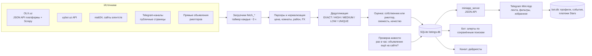
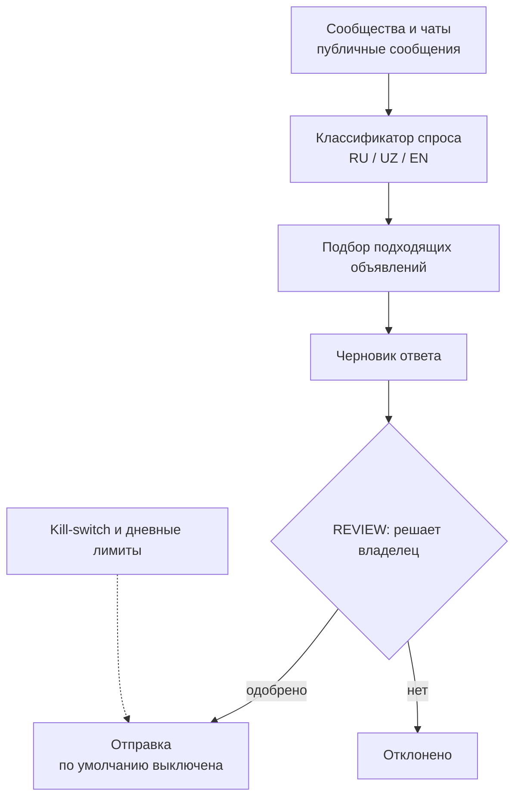

# TashRent — кейс-витрина

> **English summary.** TashRent is a Telegram Mini App + bot that aggregates long-term apartment rentals in Uzbekistan (started as Tashkent) from public sources into one deduplicated feed with an owner/realtor signal and a freshness check; the author was the first user, searching for an apartment himself. Built: OLX collection via the platform JSON API and a Scrapy collector, multi-source deduplication, a liveness checker, a Mini App, a bot, and channel/community growth tooling (review-only, outbound sending off). **Status: the repository header declares the rental project "PAUSED / PRESERVED" since 2026-09-30 because of a "fast cash" priority**, while the git history shows 105 commits between 2026-10-03 and 2026-10-07 and the production services are active (audit 2026-10-11). The documents do **not** contain a described "relocant pain found instead of the original one"; this repo says so explicitly and lists what the owner needs to add, and this is a documentation-only showcase with no source or data.

Источник: документы репозитория `tashkent-rental` (`STATE.md`, `DESIGN.md`, `QUEUE.md`, `OPERATIONS.md`,
`SCOREBOARD.md`, `PRELAUNCH_DECISIONS_2026-10-03.md`, `docs/HANDOFF-2026-10-06.md`, `docs/LAUNCH-2026-10-06.md`,
`research/*`, `growth/*`) и `STATUS_REPORT.md` от 2026-10-11. Подробно: [docs/EVIDENCE.md](docs/EVIDENCE.md),
[docs/NOT_CONFIRMED.md](docs/NOT_CONFIRMED.md), [docs/OWNER_INPUT_NEEDED.md](docs/OWNER_INPUT_NEEDED.md).

---

## 1. Проблема и для кого

**Гипотеза проекта (по документам).** Долгосрочную аренду в Ташкенте приходится искать по разрозненным источникам
(OLX, uybor, realt24, десятки Telegram-каналов), с дублями и устаревшими объявлениями. Сервис «собрал для меня весь
рынок аренды Ташкента» (`DESIGN.md`, §1 Personality): одна лента, слияние дублей, оценка «собственник / риелтор»
с причиной и уверенностью, свежесть, фильтры, избранное, жалобы (`HANDOFF_CODEX_2026-10-02.md`, §1).

**Для кого.** Главный пользователь — владелец проекта, сам искавший квартиру (dogfooding; дефолтный профиль «до $400,
1–2 комнаты, 14 дней» — `HANDOFF_CODEX_2026-10-02.md` §1; «operator's own relocation» — `research/ACQUISITION.md`).
Вторая сторона — риелторы и собственники, размещающие объявления напрямую и продвигающие их за Telegram Stars
(`STATUS_FOR_CODEX_2026-10-03.md`). Явно выделенная аудитория — релоканты (`research/ACQUISITION.md`: «релокант» —
переехавший, в основном волна из России/СНГ после 2022).

**Ядро боли в документах:** `research/MONETIZATION.md` называет «core pain (stale/fake listings)» — устаревшие и
недостоверные объявления. См. также раздел 4 про то, что в документах найдено и чего нет.

## 2. Как устроено

Python (stdlib) + SQLite + vanilla JS, один VPS (`HANDOFF_CODEX_2026-10-02.md`, §2–3).

Второй схемой описан growth-контур как он зафиксирован в `docs/HANDOFF-2026-10-06.md` («ВНЕШНЯЯ ОТПРАВКА
ВЫКЛЮЧЕНА», kill-switch `growth.agent.controls stop`) и `STATUS_FOR_CODEX_2026-10-03.md` («REVIEW mode only, no DMs,
no auto-send»).

**Что построено (по документам и STATUS_REPORT):**

| Контур | Что есть | Источник |
|---|---|---|
| Сбор OLX | Через JSON API платформы (коммит `ad3b902`, 2026-10-06) и Scrapy-коллектор в проде (`6c3d7b2`); таймер `tashrent-olxfull` | `git log`; `docs/GITHUB_REUSE_REPORT_2026-10-06.md`; `STATUS_REPORT.md` §4.2 |
| Прочие источники | uybor (API), realt24, сайты, Telegram-каналы; реестр из 98 записей | `HANDOFF_CODEX_2026-10-02.md` §2, §4 |
| Дедупликация | 5-уровневая шкала EXACT/HIGH/MEDIUM/LOW/UNIQUE; телефон + комнаты + цена ±12 % | `STATE.md`; `HANDOFF_CODEX_2026-10-02.md` §4 |
| Проверка живости | `pipeline/liveness.py`; снятые уходят из ленты, при открытии карточки перепроверка | `docs/HANDOFF-2026-10-06.md` |
| Mini App | Лента, фильтры, гео/метро, избранное, шаринг, сохранённые поиски и алерты, кабинет риелтора, RU/UZ/EN | `STATUS_FOR_CODEX_2026-10-03.md` |
| Бот | Алерты, платежи Stars (состояния created → activated → refunded, идемпотентность по charge id), `/refund` | `STATUS_FOR_CODEX_2026-10-03.md`; `OPERATIONS.md` |
| Рост | Дайджесты канала, классификатор спроса, очередь ревью, лиды риелторов; отправка наружу выключена | `docs/HANDOFF-2026-10-06.md`; `growth/*.md` |

## 3. Ключевые решения и почему

| Решение | Почему (по документам) | Источник |
|---|---|---|
| Сначала предложение (supply), потом «умность» | Dogfood-тест $200–350/мес дал всего 9–10 совпадений: «supply volume matters more than pipeline sophistication» | `STATE.md` (Real dogfood result); `QUEUE.md` |
| Сбор через публичный JSON API платформы вместо постраничного HTML | Один запрос ≈ 50 объявлений вместо 50 запросов; координаты, комиссия, статус «бесплатно» | `docs/GITHUB_REUSE_REPORT_2026-10-06.md` |
| Проверка живости как P0 перед запуском | Среди свежих найдено ~32 % снятых объявлений; «свежесть — P0 условие запуска» | `docs/HANDOFF-2026-10-06.md`; `docs/LAUNCH-2026-10-06.md` (R4.1) |
| Честный словарь свежести: «Новое» только если TashRent увидел объявление впервые за 24 ч | У OLX дата «Опубликовано» сдвигается при поднятии продавцом | `PRELAUNCH_DECISIONS_2026-10-03.md` §3 |
| Исключить `arendator_uz` из основной ленты | ~72 % строк — продажа; цены «y.e.» читались как UZS | `PRELAUNCH_DECISIONS_2026-10-03.md` §1 (рекомендация B; решение владельца в документе — открыто) |
| Growth только в режиме ревью, без массовых ЛС | «Trust first»; список «not now» принят целиком | `docs/LAUNCH-2026-10-06.md` (R8.1–8.8) |
| Монетизация не меняется до 20 активных риелторов | Нет сигнала для ценообразования | `docs/LAUNCH-2026-10-06.md` (R6.6) |
| Релизы как каталоги + `switch_release.sh`, откат одной командой | Быстрый откат без касания данных | `OPERATIONS.md` |

## 4. Результаты и цифры

| Показатель | Значение | Источник |
|---|---|---|
| Реальных объявлений на старте MVP-freeze (2026-09-29) | 638 (было 331 в начале сессии 6); рендер 625 постов | `SCOREBOARD.md` (Session 6–7) |
| Dogfood-поиск $200–350/мес | 9–10 → 30 уникальных квартир (~3×) | `SCOREBOARD.md`, `STATE.md` |
| База на 2026-10-02 | 12 779 строк → 9 534 канонических квартир после слияния дублей | `HANDOFF_CODEX_2026-10-02.md` §4 |
| Канонических объявлений при окне 30 дней | 2 764 (14 дн — 2 495; 45 дн — 3 009; 60 дн — 3 225) | `PRELAUNCH_DECISIONS_2026-10-03.md` §4 |
| Снятых среди свежих (проверка живости) | ~32 % | `docs/HANDOFF-2026-10-06.md` |
| Автотесты | 467 passed (2026-10-11); 330 на 2026-10-06; 55 на 2026-10-03 | `STATUS_REPORT.md` §4.3; `docs/HANDOFF-2026-10-06.md`; `STATUS_FOR_CODEX_2026-10-03.md` |
| Прод | `tashrent-app`, `tashrent-bot` active; таймеры channel/daily/liveness/olxfull/refresh/tgjoin | `STATUS_REPORT.md` §4.5 |
| Коммитов в репозитории | 129; из них 105 датированы 2026-10-03…2026-10-07 | `git log` (проверено при подготовке витрины) |
| Память VPS | 3,9 ГБ, делится с другим проектом; app 1,1 ГБ + bot 0,6 ГБ — запас мал | `STATUS_REPORT.md` §4.5 |
| Дедуп больших пачек | 29 000 объявлений ≈ 3 мин / 565 МБ вместо >3 ГБ | сообщение коммита `9e6086b` |

### Хронология решений

**Со слов владельца:**

- 30.09.2026 — пауза из-за приоритета быстрого заработка (подтверждено также документом `earn-or-die/factory/HANDOFF_RENTAL_PAUSED_2026-09-30.md`).
- 03–07.10.2026 — продолжил разработку до беты, прод активен (подтверждено git-историей: 105 коммитов за 03–07.10 и `STATUS_REPORT.md`).
- 09.10.2026 — после собственного поиска квартиры остановил модель «агрегатор для риелторов»: рынок держат риелторы в закрытых Telegram-группах, а найденная боль релоканта — доверие и отсев фейков, а не нехватка объявлений.

**Реальные пользователи и выручка:** по документам на 2026-10-03 в проде 0 риелторов и платежей и не сделан живой
тест оплаты 49 ⭐ с возвратом (`STATUS_FOR_CODEX_2026-10-03.md`, «Not done»). Данных о реальных пользователях и
платежах после запуска в проверенных документах **не найдено**.

### Что я узнал на собственном пути пользователя

**Со слов владельца, октябрь 2026:**

> Сам искал квартиру в Ташкенте и прошёл путь пользователя. Проблема не в нехватке объявлений, а в отсеве мусора и доверии: много объявлений только на узбекском; иностранцу часто не отвечают или не хотят сдавать; фильтр «частное лицо» на OLX фактически не работает — по моей оценке, около 90% там риелторы и объявления-приманки; нет фильтра по типу жилья (комната, подселение, квартира). В итоге помогла группа для релокантов, где ответили риелторы. Вывод: рынок держат риелторы в закрытых Telegram-группах, а агрегатор для риелторов не отвечает ни на вопрос, откуда брать арендаторов, ни зачем риелтору приходить ко мне.

«Около 90%» — оценка владельца, а не измерение.

#### Наблюдения из документов проекта

- Узкий поиск по реальному бюджету даёт мало совпадений — объём предложения важнее изощрённости пайплайна (`STATE.md`).
- Прямой доступ к OLX блокировался (403), приходилось идти через reader-прокси, затем найден публичный JSON API
  (`HANDOFF_CODEX_2026-10-02.md` §4; `docs/GITHUB_REUSE_REPORT_2026-10-06.md`).
- Значительная доля объявлений уже снята, дата публикации на OLX «врёт» из-за поднятий (`docs/HANDOFF-2026-10-06.md`;
  `PRELAUNCH_DECISIONS_2026-10-03.md` §3).
- Контактность: у многих объявлений нет телефона/Telegram, есть только «открыть оригинал»
  (`PRELAUNCH_DECISIONS_2026-10-03.md` §9, риск 2).
- Слабый приток: красная команда в пакете решений называет «almost no visitors» вероятностью HIGH
  (`PRELAUNCH_DECISIONS_2026-10-03.md` §9, риск 1).

### Почему пауза

**Причина по документам:** источник прочитан — `earn-or-die/factory/HANDOFF_RENTAL_PAUSED_2026-09-30.md` от 2026-09-30.
В нём зафиксирован статус `PAUSED / PRESERVED`: проект поставлен на паузу по директиве владельца `FAST CASH PRIORITY`
от 2026-09-30. Возобновление возможно при стабильном денежном потоке либо явном решении владельца. Это «не провал,
ничего не удалено». Дополнительных причин паузы помимо приоритета быстрых денег в документе нет.

**На момент паузы:** 638 реальных объявлений из трёх источников (OLX.uz, uybor.uz и Telegram-каналы), 20/20 `pytest`;
канал в Telegram не создан, бот не запускался, ни один реальный пользователь не видел продукт. Монетизация не проверена:
`zero users, zero revenue ever measured`.

Расхождение между статусом «PAUSED» и последующей активностью закрыто словами владельца: см. [хронологию решений](#хронология-решений).

### Боль релоканта: найденная вместо исходной

**Со слов владельца, октябрь 2026:** при поиске жилья проблема оказалась не в количестве объявлений, а в отсеве
объявлений-приманок и риелторов, доверии и ответе иностранцу, языке объявлений и отсутствии фильтра по типу жилья.
Найти помощь удалось через группу для релокантов, где ответили риелторы.

Вывод владельца: рынок держат риелторы в закрытых Telegram-группах. Открытые вопросы: откуда брать арендаторов для
агрегатора риелторов и зачем риелтору приходить в продукт.

### Какую гипотезу проверил бы дальше

- **Гипотеза:** заметный отсев объявлений-приманок и риелторов делает поиск понятнее. Проверить на подборке объявлений,
  как пользователи отличают полезные предложения от приманок и посредников; подтверждением будут повторяющиеся
  качественные отзывы, что отобранные объявления проще рассматривать и проверять.
- **Гипотеза:** фильтр по типу жилья помогает быстрее сузить выбор. Проверить, могут ли люди выбрать между комнатой,
  подселением и квартирой и считают ли результат соответствующим запросу; подтверждением будет качественная обратная
  связь, что в выдаче остаются нужные варианты.
- **Гипотеза:** понятный язык объявления, сигналы доверия и удобный первый контакт снижают барьер для иностранца.
  Проверить на сценариях обращения, какие язык, сведения и способы связи дают уверенность написать; подтверждением будут
  рассказы пользователей, что они готовы обратиться к найденному предложению.
- **Гипотеза:** доступ к закрытым риелторским группам даёт релевантные предложения, но требует ценности для риелторов.
  Проверить в разговорах с участниками групп, какую пользу они видят для арендатора и риелтора; подтверждением будет
  содержательное согласие участвовать или делиться предложениями без давления.

## 5. Ограничения и что дальше

- Хронология статуса «пауза» и последующей активности приведена в разделе [«Хронология решений»](#хронология-решений).
- Рабочее дерево грязное: 23 905 untracked и 625 удалённых tracked-файлов (`posts/*.txt`), много одноразовых `stitch_*.py`
  (`STATUS_REPORT.md` §1 п.9, §4.4).
- Не пройдено человеком: живая оплата 49 ⭐ с возвратом; создание канала и `CHANNEL_ID`; регистрация Main Mini App в
  BotFather; проверка в реальном Telegram-клиенте (`STATUS_FOR_CODEX_2026-10-03.md`).
- Открытые решения владельца: вступление в релокантские группы (Telethon), birbir.uz за Cloudflare — нужно явное
  разрешение, автоудаление старых объявлений, домен вместо `nip.io`, hardening nginx/systemd (`docs/HANDOFF-2026-10-06.md`).
- Growth-агент: внешняя отправка выключена; живое включение не проверено (`STATUS_REPORT.md` §4.2).
- Юридический риск скрейпинга указан в красной команде как LOW/MEDIUM и требует тейкдаун-процесса
  (`PRELAUNCH_DECISIONS_2026-10-03.md` §9, риск 10).
- Линт/типизация для Python не настроены (`STATUS_REPORT.md` §4.3).

## 6. Как запустить

Исходники продукта приватные; данные (объявления, пользователи, платежи) не публикуются. Демо-репозитории модулей —
`model-pool`, `quality-gate`, `lead-hunter`, `agent-runtime` в каталоге портфолио относятся к Developer Factory и
GiftQuest (developer-factory-case), а не к TashRent. Модуль сбора TashRent как
отдельное демо в портфолио пока не выделен (в `STATUS_REPORT.md` §6 назван кандидатом «TashRent Ingestion», ~85 %).

## 7. Моя роль

Продуктовая постановка, архитектура и приёмка — мои. Код написан ИИ-агентами (Claude, Codex) под моим управлением.

Я был первым пользователем и заказчиком (искал квартиру сам), принимал результаты по тестам, ручным QA и аудитам.
